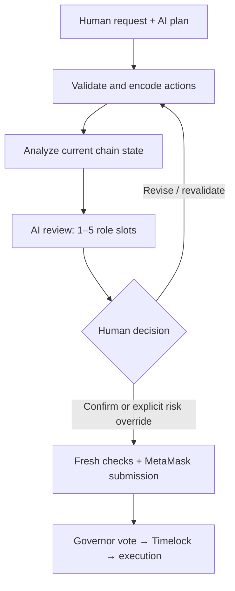

# YanFu Governance Compiler · v1.0

**Turn natural-language governance requests into reviewable, executable DAO proposals—with deterministic checks and a human decision before signing.**

YanFu is a local development application for the gap between a governance idea and an Ethereum Governor transaction. AI proposes a semantic plan; deterministic code validates and encodes it; a role-based AI panel reviews chain evidence; a human decides what reaches the wallet.

- **Intent fidelity:** check explicit recipients, amounts and protected values against executable actions.
- **Reviewable execution:** inspect exact Governor targets, values and calldata alongside current-chain evidence.
- **Human authority:** edit semantic actions or the exact payload, revalidate, and explicitly acknowledge stale or negative AI advice.



A revised proposal loses current AI approval. Re-review is recommended; a controlled human override requires prior signed review lineage, fresh validation and the relevant acknowledgments. **Proposal submission does not execute Treasury transfers.**

**Scope:** local Hardhat development and governance research. v1.0 is the public product label (`1.0.0` in npm); it does not imply production certification. Real EVM and HTTP tests are included. Actual MetaMask UI and live-provider acceptance remain separate checks.

## Contents

1. [Prepare the environment](#1-prepare-the-environment)
2. [Install and create local configuration](#2-install-and-create-local-configuration)
3. [Configure an AI provider](#3-configure-an-ai-provider)
4. [Start the chain and deploy](#4-start-the-chain-and-deploy)
5. [Start the backend and frontend](#5-start-the-backend-and-frontend)
6. [Connect MetaMask and try a proposal](#6-connect-metamask-and-try-a-proposal)
7. [Configuration reference](#7-configuration-reference)
8. [Troubleshooting](#8-troubleshooting)
9. [Tests and optional modules](#9-tests-and-optional-modules)
10. [How YanFu fits the ecosystem](#10-how-yanfu-fits-the-ecosystem)
11. [Publishing and security](#11-publishing-and-security)

## 1. Prepare the environment

The commands below use **Windows PowerShell**, from the directory containing `package.json`. macOS/Linux can use the same npm commands; shell-specific environment-variable syntax is shown later.

| Requirement | Setup |
|---|---|
| Node.js + npm | Install Node **24.x** from [nodejs.org](https://nodejs.org/en/download). This package was tested with Node **24.22.1** and npm **11.9.0**. Node 22–24 is declared; Node 18 is outside this package's supported range. |
| Git | Install from [git-scm.com](https://git-scm.com/downloads) for publication checks and GitHub use. |
| Editor | VS Code is convenient; any text editor works. |
| Static frontend server | VS Code **Live Server**, or an equivalent HTTP server on port 5500. |
| Wallet | Install MetaMask from its [official website](https://metamask.io/download/) in a separate development browser profile. |
| AI access | One supported provider account/key, or an installed local Ollama model. Only the provider you select needs credentials. |

Verify in a new terminal:

```powershell
node --version
npm --version
git --version
```

Hardhat, ethers and OpenZeppelin are project dependencies; **do not install or upgrade them globally**. The lockfile pins the tested stack: Hardhat 2.29.1, ethers 5.8.0 and OpenZeppelin 4.9.6. Solidity 0.8.20 is selected by `hardhat.config.js`; initial compilation may download the compiler.

## 2. Install and create local configuration

Extract the full project package into a **new folder**, then open that folder in VS Code. A clean folder avoids mixing old release documents or test filenames into this new repository.

```powershell
cd .\YANFU_GOVERNANCE_COMPILER
npm ci
npm run setup
npm run compile
```

`npm run setup` creates these ignored local files **only when missing**:

| Local file | Safe template | Purpose |
|---|---|---|
| `.env` | `.env.example` | Provider keys, local backend settings and optional receipt secret |
| `config/chain.config.json` | `config/chain.config.example.json` | Local RPC, chain ID and contract addresses; deployment overwrites it |
| `config/registered-contracts.json` | `config/registered-contracts.example.json` | Your additional contract instances; empty by default |

The templates contain no real credentials. Existing local settings are preserved if setup is run again. The public package deliberately omits the real local files.

**Moving from an existing installation:** back up the old folder privately. Copy only your `.env` and, if reusing the same still-running chain, its matching `config/chain.config.json` and registered-contract settings into this new folder. Do not copy old `node_modules`, build output or `.git` history. Use `npm ci`. Restart the backend and refresh the frontend. The application keeps its existing workflow-storage and receipt formats; rebadging alone does not migrate or erase them.

## 3. Configure an AI provider

Open **`.env`**, not `.env.example`. Set the key for the provider you intend to use. The bundled ModelScope default looks like this:

```dotenv
PORT=3000
YANFU_BIND_HOST=127.0.0.1
AI_DEFAULT_MODEL=modelscope:qwen3.5-27b
MODELSCOPE_BASE_URL=https://api-inference.modelscope.cn/v1
MODELSCOPE_API_KEY=replace_with_your_own_key_locally
```

The value above is a placeholder. Do not commit an actual key. Leave unused provider keys blank. Choose a model your account can actually access; bundled catalog entries are preserved configuration, **not a promise of current provider availability**.

| Provider | Key in `.env` | Other relevant settings |
|---|---|---|
| ModelScope | `MODELSCOPE_API_KEY` | `MODELSCOPE_BASE_URL` |
| OpenAI | `OPENAI_API_KEY` | `OPENAI_BASE_URL`; model-specific transport is declared in the catalog |
| Gemini | `GEMINI_API_KEY` | `GEMINI_BASE_URL` |
| Anthropic | `ANTHROPIC_API_KEY` | `ANTHROPIC_BASE_URL` |
| Local Ollama | None | `OLLAMA_URL`, `OLLAMA_TAGS_URL`; install the selected model first |

`AI_DEFAULT_MODEL` must equal a model's **`id`** in `config/models.config.json`, not its display label or provider-side model string. Compile, Analyze and Review also have model selectors in the UI. Select an available model at each stage; a configured default does not replace those selections.

For local Ollama, one existing catalog choice is `ollama:qwen2.5:7b`. Run Ollama, install that exact model with `ollama pull qwen2.5:7b`, then set `AI_DEFAULT_MODEL=ollama:qwen2.5:7b`. Local model capability and JSON reliability still need evaluation.

The backend loads the root `.env` on startup. **Restart `npm run server` after editing it.** Existing shell environment variables take precedence over `.env`. For a temporary PowerShell override in the terminal that starts the backend:

```powershell
$env:YANFU_LOG_LEVEL='info'
npm run server
# After stopping the server with Ctrl+C:
Remove-Item Env:YANFU_LOG_LEVEL
```

On macOS/Linux, the equivalent one-command override is `YANFU_LOG_LEVEL=info npm run server`.

An optional stable receipt secret lets signed review receipts survive a backend restart. To generate one without displaying it, after setup run:

```powershell
node -e "const fs=require('fs'),c=require('crypto');fs.appendFileSync('.env','\nYANFU_REVIEW_ATTESTATION_SECRET='+c.randomBytes(48).toString('hex')+'\n')"
```

Run this once and keep the value private. Do not add duplicate entries. If unset, the backend creates an ephemeral secret; restarting then invalidates older receipts and requires a new review. Receipts expire after 24 hours in either case.

## 4. Start the chain and deploy

**Terminal A — keep it open:**

```powershell
npm run node
```

This starts the disposable Hardhat network at `http://127.0.0.1:8545`. Its printed accounts and private keys are public development fixtures. Never use them with real assets, and never upload the node log.

**Terminal B — deploy once to that running node:**

```powershell
npm run deploy
```

Deployment creates MyToken, TimelockController, MyGovernor, Treasury, DAOContractFactory and DAOSettings, then writes actual addresses and chain ID into `config/chain.config.json`.

| Default | Value |
|---|---|
| Hardhat chain ID | **31337**; use the actual generated config if customized |
| MyToken supply | 1,000,000 MTK |
| Treasury token allocation | 900,000 MTK |
| Deployer token balance | 100,000 MTK |
| Treasury ETH balance | Initially zero |
| Governor voting delay / period | 1 block / 7,200 blocks |
| Timelock minimum delay | 120 seconds |

A restarted disposable node loses its state. Redeploy after restarting and refresh the frontend. Do not assume addresses in an example file point to live contracts.

## 5. Start the backend and frontend

**Terminal C — keep it open:**

```powershell
npm run server
```

Check [http://127.0.0.1:3000/api/health](http://127.0.0.1:3000/api/health). It should return `success: true` and `version: "1.0.0"`.

In VS Code, open the project folder, right-click `frontend/index.html`, and select **Open with Live Server**. With the project root served, open:

```text
http://127.0.0.1:5500/frontend/index.html
```

If your server's document root is the `frontend/` directory itself, use `http://127.0.0.1:5500/index.html` instead. Both work. **Do not open the HTML through `file://`.**

Default allowed frontend origins are localhost or 127.0.0.1 on ports **5500 and 5501**. The browser API endpoint is `http://127.0.0.1:3000`.

For this first run, keep the default ports. If you change the backend port, changing `.env` alone is insufficient: update `API_BASE` in `frontend/assets/js/api.js` and `frontend.apiBaseUrl` in `config/app.config.json` as well. If you change the frontend port, add that exact origin to `YANFU_ALLOWED_ORIGINS` and restart the backend. Do not use a wildcard origin.

## 6. Connect MetaMask and try a proposal

Add a local custom network in MetaMask using its [official network instructions](https://support.metamask.io/configure/networks/how-to-add-a-custom-network-rpc/):

| Field | Value |
|---|---|
| Network name | YanFu Local |
| RPC URL | `http://127.0.0.1:8545` |
| Chain ID | `31337`, or the actual ID in your deployment output |
| Currency symbol | ETH |
| Block explorer | Leave blank for the disposable local chain |

Import **only a disposable Hardhat account** into your development profile using MetaMask's [account import instructions](https://support.metamask.io/start/use-an-existing-wallet/). The deployer account is convenient because it has local ETH and MTK. Copy its test key directly from your own Hardhat terminal into MetaMask; never into a project file, chat, screenshot or GitHub.

Start with a no-funds proposal:

> Create exactly one governance proposal to set the DAOSettings message to "Hello from YanFu". Do not transfer any funds or change voting parameters.

1. **Generate:** choose a configured model and compile the request. Inspect the semantic actions and encoded proposal.
2. **Analyze:** run chain-grounded analysis. Resolve failed simulation or missing contract configuration.
3. **AI Review:** select 1–5 model/role slots and run the panel. A model may be reused for different roles; identical model+role pairs are blocked.
4. **Human Confirm:** inspect the actual targets, values and calldata, run fresh validation, and confirm. If you edit the proposal, follow the new validation and rewrite acknowledgments; prior AI approval becomes stale.
5. **Submit:** connect MetaMask on the correct local chain, compare transaction details, and approve or cancel the local transaction yourself.

Success here means **Governor.propose was mined**. It does not mean the settings change or a Treasury payment executed. Voting, quorum, queueing and the Timelock delay still apply. See [GOVERNANCE_LIFECYCLE.md](docs/GOVERNANCE_LIFECYCLE.md) for the local console steps; the web workflow is a proposal-preparation/submission tool, not a complete voting portal.

For ETH-payment experiments, fund the Treasury from a local test account first. For voting experiments, delegate voting power before creating the proposal. Neither action is needed merely to compile the message example.

## 7. Configuration reference

All JSON files require valid JSON: double quotes, no comments, no trailing commas. Use address strings and decimal strings where the supplied examples do. Validate edits with `npm run check`.

| File | What to change | Publication policy |
|---|---|---|
| `.env` | Provider keys, local URLs, timeout/logging controls, optional receipt secret | **Ignored**; blank `.env.example` is tracked |
| `config/chain.config.json` | RPC and deployed contract addresses; normally written by deployment | **Ignored**; track its example only |
| `config/deployment.config.json` | Initial Timelock delay, Treasury allocation and executor mode | Safe defaults tracked; applies to future deployments |
| `config/models.config.json` | Model `id`, provider-side `model`, label and supported transport flags | Tracked; use env-variable names, never embedded credentials |
| `config/reviewers.config.json` | Role definitions, default assignments and consensus policy | Tracked; changing these changes governance-review behavior |
| `config/app.config.json` | Workflow policies, logging and frontend metadata | Tracked; keep safety gates enabled for the standard workflow |
| `config/registered-contracts.json` | Additional deployed contracts, exact ABIs and opt-in capabilities | **Ignored**; templates include disabled examples |
| `config/proposal-elements.json` | Built-in typed capabilities and encoding rules | Tracked; advanced changes require tests |
| `config/input-validation.json` | Explicit-intent validation rules and aliases | Tracked; advanced |
| `config/prompt-templates.json` / `review-policy.json` | AI instructions and deterministic review policy | Tracked; advanced |

For full field examples and environment defaults, see [CONFIGURATION.md](docs/CONFIGURATION.md). For external contracts, see [CAPABILITIES.md](docs/CAPABILITIES.md). Do not put secrets in any file returned by `/api/config/public`.

## 8. Troubleshooting

| Symptom | Check |
|---|---|
| `npm` not found or engine warning | Reopen the terminal after installing Node; verify Node 24 is active. Use `npm ci` in the project root. |
| Missing configuration file | Run `npm run setup`. It never overwrites existing local files. |
| Missing API key / no available model | Edit `.env`, restart backend, and select a provider/model your account supports. `CONFIGURED` does not verify entitlement, quota or endpoint health. |
| `ENOTFOUND`, timeout or provider 429 | Inspect DNS/network/quota and the exact provider error. Do not treat the failed review as approval. |
| CORS / failed fetch | Keep frontend on HTTP 5500/5501, backend on 127.0.0.1:3000, and ensure the exact origin is allowed. |
| Chain unavailable / no contract code | Keep `npm run node` running and redeploy to it. Check generated addresses and chain ID. |
| Wrong wallet network | Match MetaMask to `config/chain.config.json`; a historical 1337 entry will not match a default 31337 chain. |
| Receipt expired / invalid after restart | Re-run AI Review. Stable secret configuration does not extend the 24-hour expiry. |
| Confirm page locked | Complete Analyze and AI Review in order. Direct links do not bypass prerequisites. |
| Edited proposal will not submit | Apply edits, revalidate, and complete the rewrite and review-risk acknowledgments. Unapplied editor changes block submission. |
| Nonce mismatch after restarting Hardhat | Use the new disposable chain and MetaMask's test-account activity reset procedure as appropriate; never reset production-account state for this exercise. |

## 9. Tests and optional modules

These come after the quick start because they are developer tools, not prerequisites for understanding the interface.

```powershell
npm run check
npm run check:publication
npm run test:evm
npm run test:http-evm
```

For the combined regression gate, first stop persistent local services so **8545 and 3300 are free**:

```powershell
$env:YANFU_RELEASE_EVM='1'
npm run test:release-gate
Remove-Item Env:YANFU_RELEASE_EVM
```

The HTTP test creates a temporary project and disposable chain; it does not overwrite your local deployment configuration. EVM tests include Treasury atomicity and Governor/Timelock execution. The wallet adapter uses an EIP-1193 test transport; **it is not MetaMask extension automation**.

`npm run test:auto-ai` is a separate, opt-in live-provider suite. It can incur API usage, requires a running backend and deployed chain, and does not submit transactions. There are 242 cases: 101 enabled by default and 141 requiring optional fixtures. See [TESTING.md](docs/TESTING.md) for smoke filters, reviewer overrides and output files. Optional contract packs and five-role tests are also documented there.

## 10. How YanFu fits the ecosystem

YanFu focuses on **pre-submission intent verification and accountable review**. It uses existing governance contracts rather than replacing their voting and permission mechanisms.

| Related GitHub project | Documented focus | YanFu's different focus |
|---|---|---|
| [OpenZeppelin Contracts](https://github.com/OpenZeppelin/openzeppelin-contracts) | Reusable smart contracts, including Governor voting/execution components | A natural-language planning, deterministic encoding and review interface above the Governor layer |
| [Aragon OSx](https://github.com/aragon/osx) | DAO permissions and modular governance through plugins | Inspecting a proposed action set against original intent and fresh chain evidence before wallet submission |
| [Snapshot](https://github.com/snapshot-labs/snapshot-docs) | Snapshot's off-chain voting, proposal validation and flexible voting strategies | Preparing on-chain Governor calldata with explicit human edit/confirmation gates |
| [Snapshot MCP](https://github.com/snapshot-labs/snapshot-mcp) | AI-assistant access to governance queries and actions; repository points to its successor | A dedicated compiler–review–human-confirm pipeline with signed review-context receipts |

The distinctive combination is capability-bounded planning, typed encoding, amount/recipient checks, shared chain evidence across up to five roles, and a controlled human override path. This is a scope comparison, **not a benchmark, exhaustive feature audit, or claim that other projects cannot implement similar checks**. Snapshot X is a separate on-chain protocol and is not characterized as off-chain here. Sources and a reusable introduction are in [INTRODUCTION.md](docs/INTRODUCTION.md).

## 11. Publishing and security

The repository is prepared as a fresh **v1.0** project. npm metadata uses **1.0.0**. Internal schema versions, provider model IDs and the saved-workflow key are compatibility identifiers and deliberately keep their original values.

The package contains no real `.env`, wallet key, deployed local configuration, `node_modules`, generated artifacts or test output. `.gitignore` covers these files, and safe examples are included. **Ignore rules do not remove files already tracked by Git**; use a new repository and review staged files. See [PUBLICATION.md](docs/PUBLICATION.md).

See [SECURITY.md](SECURITY.md) and [VALIDATION.md](docs/VALIDATION.md) for current test scope and limitations. No mainnet readiness, independent audit, or live model availability is claimed. The package preserves existing per-file license headers; a repository-wide license has not been selected for you.
