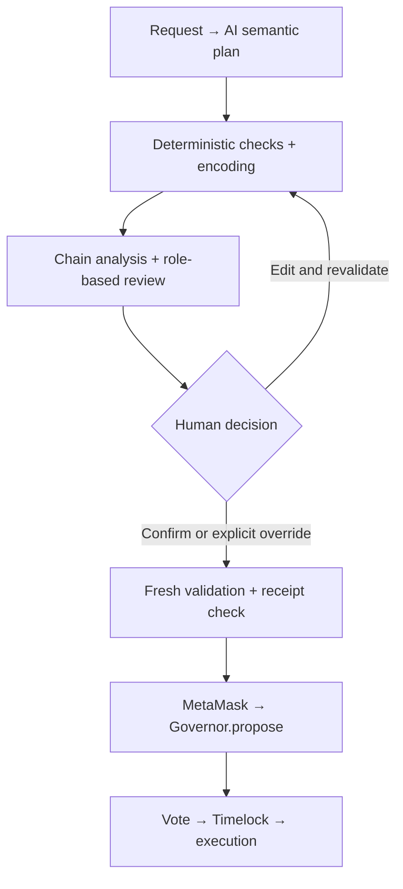

# YanFu Governance Compiler · v1.0

## GitHub About description

AI-assisted DAO proposal compiler with deterministic intent checks, role-based review, and explicit human confirmation before Governor submission.

## Project introduction

Governance proposals often begin as plain-language requests but end as contract addresses, numeric values and calldata. YanFu makes that translation inspectable. It maps a request to configured capabilities, validates and encodes the action set, checks current chain state, and gives up to five role-based reviewers the same evidence before a human decides what to sign.

YanFu's contribution is the combination of **bounded AI planning**, **deterministic source-to-execution checks**, and **explicit human authority**. Review-context fingerprints bind the executable proposal to source text and chain identity. Server-signed receipts preserve review lineage. Human edits are supported, but they invalidate current approval and require fresh validation and acknowledgments. The AI panel advises; it never owns the wallet.

## Distinctive design choices

- AI chooses among configured capabilities; deterministic code owns type checks, unit conversion and ABI encoding.
- Explicit recipient/amount checks can flag substitutions and omitted or additional payments. The natural-language grammar is deliberately bounded, not a proof for every possible sentence.
- Review slots specialize in general governance, Treasury impact, intent fidelity, security/execution, and governance mechanisms. The same model may fill different roles, but repeated models are not independent model-family consensus.
- Semantic rebuilds and exact payload overrides are separate human editing paths. A changed payload cannot retain current AI approval.
- Tests distinguish mocked guards, real EVM execution, HTTP/RPC integration, live AI calls and actual wallet UI acceptance.

## Position alongside related projects

| Project | Primary documented scope | Where YanFu concentrates |
|---|---|---|
| OpenZeppelin Contracts / Governor | Contract building blocks for proposal, voting and execution mechanics | Preparing and reviewing the exact action payload that will be submitted to a Governor |
| Aragon OSx | DAO permissions, factories, plugin lifecycle and governance plugins | Source-intent checks and human approval of proposed actions |
| Snapshot | Off-chain proposal/voting workflows with configurable strategies and validation | Deterministically encoded on-chain Governor proposals; this row does not describe Snapshot X |
| Snapshot MCP | Tools for AI assistants to query governance and act through Snapshot APIs | A prescribed compile → analyze → review → human-confirm workflow and signed review lineage |

This comparison describes architectural focus, not verified feature absence or superior safety. YanFu does not claim an Aragon or Snapshot integration. Its bundled contracts use OpenZeppelin. These projects can be complementary.

## Sources

Reviewed November 2, 2026; project capabilities may change.

1. [OpenZeppelin Contracts repository](https://github.com/OpenZeppelin/openzeppelin-contracts) and [Governor guide for the library family used here](https://docs.openzeppelin.com/contracts/4.x/governance).
2. [Aragon OSx repository and architecture](https://github.com/aragon/osx).
3. [Snapshot documentation repository](https://github.com/snapshot-labs/snapshot-docs).
4. [Snapshot MCP repository](https://github.com/snapshot-labs/snapshot-mcp), which points to its successor repository.

## Suggested repository metadata

- Name: `yanfu-governance-compiler`
- Release/tag: `v1.0`
- Topics: `dao`, `governance`, `ethereum`, `solidity`, `hardhat`, `ai`, `human-in-the-loop`
- Description: use the GitHub About sentence above.

These are prepared metadata, not a created GitHub repository or published release.
